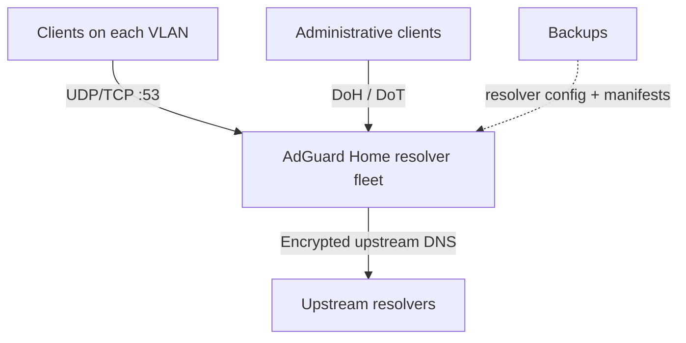

DNS is invisible right up until it is not. When it fails, the symptoms are wonderfully unhelpful: a phone cannot load a page, a TV cannot find a streaming service, and every smart-home integration suddenly looks guilty.

That is why replacing a working legacy `dnsmasq` setup with an AdGuard Home resolver fleet was not a “replace the container and see what happens” job. The goal was encrypted upstream DNS, filtering, backups, and a cleaner operating model—without converting the house into a debugging exercise.

The important lesson was simple: a DNS migration is not complete when a new dashboard loads. It is complete when the traffic clients actually send has been proven to work, and the old system is still easy to restore.

## The migration strategy: serial, reversible, and evidence-driven

The destination was three VLAN-53 hosts running AdGuard Home. Each host had to serve ordinary UDP and TCP DNS locally, while the fleet also needed encrypted DNS capabilities (DoH and DoT) and a backup path.

Rather than move everything at once, I treated every host as an independent change with the same sequence:

1. Archive the legacy service and its effective configuration.
2. Deploy one replacement resolver with an explicit network attachment and mounted configuration.
3. Recreate the container when configuration changes—not merely restart it.
4. Validate the protocols clients will use on the wire.
5. Confirm the host is independently recoverable before advancing to the next one.

That gave the rollout a narrow blast radius. A failed first host was an inconvenience; a failed all-at-once cutover would have been a house-wide outage.

## The architecture



The operational boundary matters. The resolver receives and answers DNS requests; the container runtime owns networking and mounts; the deployment manifest is the declared configuration; and the validation commands are the proof that the declaration became reality.

## Advertise encrypted DNS with DHCP option 162

Building encrypted DNS endpoints is only half the client-side story. I also wanted DHCP clients to learn that the local resolvers offer Discovery of Network-designated Resolvers (DNR), rather than requiring a per-device browser or operating-system setting.

For IPv4, that information travels in DHCP option 162. In UniFi, I created one reusable custom DHCP option named `DNR`, with code `162` and the `hexarray` type, then attached it only to the two intended DHCP scopes: the general LAN and the Home Assistant VLAN. The test VLAN came first; the production scopes came only after the payload was observed on the wire and the advertised endpoints answered.

The option value is not a hostname pasted into a text box. It is a binary DNR configuration encoded as hexadecimal. The payload we used described:

- the authenticated DNS name (ADN) for the resolver service;
- the three private resolver IPv4 addresses;
- an ALPN service parameter for HTTP/2 (`h2`); and
- the DNS-over-HTTPS path template, `/dns-query{?dns}`.

UniFi's important wrinkle is the value format: its `hexarray` field expects colon-delimited octets, such as `00:01:…`, rather than a JSON structure, a plain URL, or an unseparated hexadecimal string. Build the DNR binary value with a standards-aware encoder, then convert it to that colon-delimited form before saving it. Do not hand-edit a byte sequence unless you can independently decode it afterward—one incorrect length field can make a valid-looking DHCP setting unusable.

The safe rollout sequence was:

1. Create the custom option in UniFi with code `162`, type `hexarray`, and the encoded DNR payload.
2. Attach it to a disposable test network, not every production scope.
3. Obtain a brand-new lease and inspect both the DHCP OFFER and ACK for option 162.
4. Make certificate-verified DoH requests to every advertised resolver address using the advertised DNS name.
5. Attach the same shared option to the selected production scopes only after those checks pass.

This separates delivery from adoption. A packet capture proved that the 63-byte option appeared in both OFFER and ACK, and direct HTTP/2 DoH probes to all three advertised addresses returned HTTP 200. That proves the DHCP server delivered a coherent configuration and the resolver endpoints were reachable with valid TLS. It does **not** prove every client will automatically enable DNR: support is operating-system and DHCP-client dependent. For example, the Linux host used for infrastructure management ran a `systemd-networkd`/`systemd-resolved` version without DNR support, so renewing its lease would have been disruptive without validating automatic adoption.

Also account for lease timing. Existing clients usually need a lease renewal (or a deliberate reconnect) before they see a newly attached DHCP option. Static-addressed devices and IPv6-only clients need their own configuration path; DHCPv4 option 162 does not configure them.

## Preflight the boring dependencies

Most of the work was not DNS-specific. The migration exposed assumptions that a green container status would never reveal:

- a Python-version mismatch in a helper or provisioning path;
- a missing or incorrectly named container network parent;
- an image pull that did not leave the expected image locally available;
- split-DNS behavior that needed to remain intact for local names; and
- a mounted configuration change that had not reached the running container.

These are exactly the failures worth turning into preflights. Before changing a resolver, check that the runtime exists, the parent network is present, the intended image can be pulled, the configuration parses, and the old-service archive is readable.

```bash
# Illustrative preflight—adapt names and paths to your environment.
docker network inspect dns_vlan >/dev/null
docker image inspect adguard/adguardhome:latest >/dev/null \
  || docker pull adguard/adguardhome:latest
test -r /srv/dns/adguard/AdGuardHome.yaml
```

Do not copy this literally. Pin image versions in a real deployment, and keep configuration, certificates, and backups outside the container filesystem.

## A mounted config is not a deployment until the container is recreated

This was the most useful operational rule from the migration.

It is easy to edit a bind-mounted YAML file, restart a process, and assume the new setting won. But a running container may have started with a different mount, an old environment value, or state already loaded into memory. “The file looks right on the host” is not verification.

For changes that alter ports, networking, mounts, or startup configuration, make recreation explicit:

```bash
docker compose up -d --force-recreate adguard-home
docker compose ps
```

Then verify the runtime view: inspect the mounted path, attached interfaces, and logs. Treat a restart as a lifecycle event; treat recreation as configuration convergence.

## Validate the wire, not the UI

The dashboard can be healthy while one of the protocols clients rely on is broken. The minimum proof set should match the services you claim to provide.

```bash
# UDP DNS
dig @DNS_SERVER example.com A +time=2 +tries=1

# TCP DNS
dig @DNS_SERVER example.com A +tcp +time=2 +tries=1

# DoT (requires a TLS-aware DNS client and a valid server name)
kdig @DNS_SERVER +tls-ca +tls-host=DNS_NAME example.com A

# DoH: query through the configured HTTPS endpoint with a suitable client.
```

For local zones, add a split-DNS assertion too: query a representative internal name and confirm that it resolves to the expected private answer. A public `example.com` response proves upstream reachability, not that local name resolution survived.

Record results per host: timestamp, resolver, protocol, queried name, response status, and the intended fallback or rollback action. That receipt is more valuable than a vague “looks good” in a deployment log.

## Do not widen a failed rollout

The safest rollout gate is also the least glamorous: if any proof fails, stop. Do not move to the next resolver because the failure “is probably just one protocol,” and do not retire the legacy service because the replacement answers one query.

For each host, the gate was:

- the container is running with the expected config and network;
- UDP and TCP DNS work;
- DoH and DoT checks pass where enabled;
- split DNS returns the expected local answer;
- a backup exists; and
- the legacy resolver can still be restored without improvisation.

Only then should the next host receive the same treatment. After all three meet the gate, stop the legacy containers—but retain the archive long enough to prove steady operation under normal household use.

## The transferable lesson

High availability is useful, but reversibility is what makes a migration calm. Three resolvers are not a safety net if all three inherit the same unchecked configuration mistake.

The robust pattern is to turn transitions into small claims that can be verified: *the image is available; the network is correct; the config reached the process; each protocol works on the wire; the old path remains recoverable.* Those claims make a home-network change legible, repeatable, and much less likely to become a family-wide outage.

## Recreation checklist

- Export and archive the legacy resolver’s configuration and deployment definition.
- Pin the replacement image and store config, certificates, and backups outside the container.
- Verify the host runtime, network parent, image availability, and configuration before cutover.
- Migrate one resolver at a time.
- Recreate containers after mount, network, port, or startup-config changes.
- Test UDP, TCP, encrypted DNS endpoints, and at least one internal split-DNS name.
- If using DHCP option 162, capture a fresh DHCP OFFER and ACK, then verify the advertised DoH endpoint on every advertised address.
- Capture a small validation receipt for every host.
- Stop rollout on any failed proof; restore the known-good path before investigating.
- Retire the legacy service only after the fleet has passed checks and operated normally.

## For agents

An agent can make this kind of infrastructure work safer, but only if it is constrained by evidence.

- Produce a receipt for each transition rather than narrating intent as success.
- Treat deployment, restart, and verified service availability as different states.
- Refuse to advance the rollout after a failed proof point.
- Never invent a network parent, interface, resolver address, certificate name, or rollback target; discover and present them for confirmation.
- Keep secrets out of command output and use existing secret references rather than copying credentials into manifests.

That is the useful role for automation here: not “make the changes faster,” but “make it harder to lose track of what is actually true.”
